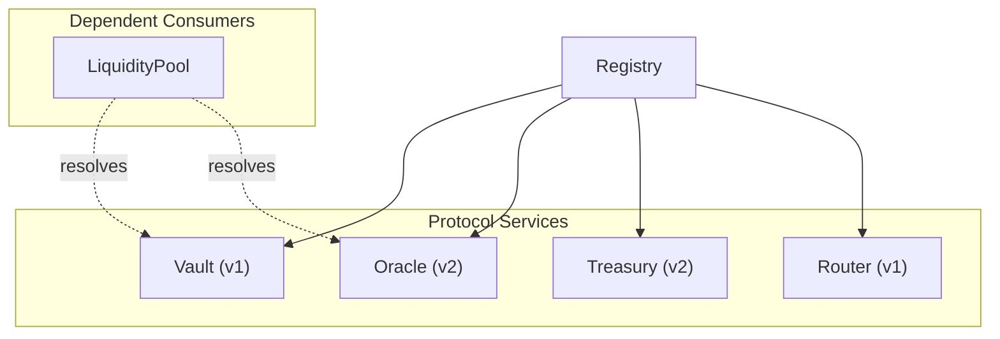

# soroban-testkit-fixtures

A reusable test context inspired by Foundry's `setUp()`: one place to build the environment, admin and user addresses every test needs.

<div class="tk-spec">
  <div class="tk-spec__item"><span class="tk-spec__key">Package</span><span class="tk-spec__value">soroban-testkit-fixtures</span></div>
  <div class="tk-spec__item"><span class="tk-spec__key">Modules</span><span class="tk-spec__value">lib · builder · mock · migration · event_indexer · gas_exhaustion · congestion · eviction · protocol_registry · failure_injector</span></div>
  <div class="tk-spec__item"><span class="tk-spec__key">Default</span><span class="tk-spec__value">mock_all_auths on</span></div>
</div>

## What `TestContext` gives you

| Field | Value |
|-------|-------|
| `ctx.env` | A fresh `Env`, auth mocked unless you opt out |
| `ctx.admin` | A generated `Address` to act as deployer / owner |
| `ctx.users` | A `Vec<Address>` you extend with `add_user()` |
| `ctx.mock_auths` | The auth policy the context was built with, re-applied by `reset()` |

## Basic usage

```rust
use soroban_testkit_fixtures::TestContext;

let ctx = TestContext::new();
// ctx.env — pre-configured Env with mock_all_auths
// ctx.admin — generated admin address
// ctx.users — empty vec, add users as needed
// ctx.user(i) — safe accessor with diagnostic panic message
```

## Accessing users

Retrieve generated user addresses with `ctx.user(index)`:

```rust
let ctx = TestContextBuilder::new().with_users(3).build();
let alice = ctx.user(0);
let bob = ctx.user(1);
```

When called with an index out of bounds, `ctx.user(i)` panics with a descriptive diagnostic pointing directly at `TestContextBuilder::with_users`:

```text
user index out of bounds: index is 2 but context holds 2 users (did you call TestContextBuilder::with_users(3)?)
```

## Builder pattern

Describe the context you want instead of assembling it:

```rust
use soroban_testkit_fixtures::builder::TestContextBuilder;

let ctx = TestContextBuilder::new()
    .with_users(5)            // Pre-generate 5 user addresses
    .without_mock_auths()     // Disable automatic auth mocking
    .build();
```

<div class="tk-callout tk-callout--tip">
  <span class="tk-callout__title">When to opt out of mocked auth</span>
  <p>Keep <code>mock_all_auths</code> for behaviour tests. Call <code>without_mock_auths()</code> as soon as a test asserts <em>who</em> had to sign — that is <a href="./assert.html">AuthMatcher</a> territory.</p>
</div>

## Moving the ledger clock

Time-dependent contracts — vesting, auctions, lockups — need the ledger to
advance between two calls. `TestContext` exposes the four operations that cover
almost all of that without building a `LedgerInfo` by hand:

| Method | Effect |
|--------|--------|
| `ctx.timestamp()` | The unix timestamp the ledger reports |
| `ctx.sequence()` | The ledger sequence number the ledger reports |
| `ctx.set_timestamp(t)` | Jump to absolute time `t` |
| `ctx.advance_time(s)` | Add `s` seconds, return the new timestamp |
| `ctx.advance_ledger(n)` | Add `n` to the sequence, return the new height |
| `ctx.archive_expired(n)` | Advance `n` ledgers, archive everything past its TTL, return the `ArchivalSweepSimulator` holding it |

```rust
use soroban_testkit_fixtures::TestContext;

let mut ctx = TestContext::new();
ctx.set_timestamp(1_700_000_000);
// ... assert the position is locked

let unlocked_at = ctx.advance_time(86_400 * 30); // 30 days later
assert_eq!(unlocked_at, 1_702_592_000);
// ... assert the position is claimable
```

<div class="tk-grid tk-grid--2">
  <div class="tk-card">
    <span class="tk-card__kicker">Time and height are separate</span>
    <h3 class="tk-card__title">Advance only what you assert</h3>
    <p class="tk-card__body"><code>advance_time</code> leaves the sequence alone and <code>advance_ledger</code> leaves the clock alone. A real ledger close moves both, so a test that wants the full picture calls each — and a test that only cares about TTL expiry does not silently move the clock.</p>
  </div>
  <div class="tk-card tk-card--accent">
    <span class="tk-card__kicker">A fresh env opens at zero</span>
    <h3 class="tk-card__title">Set before you advance</h3>
    <p class="tk-card__body">The SDK test env starts at timestamp <code>0</code> and sequence <code>0</code>, so <code>advance_time(3_600)</code> lands on <code>3_600</code> rather than on wall-clock time. Pin an absolute moment with <code>set_timestamp</code> first when the test reads better as a date.</p>
  </div>
</div>

Both helpers saturate instead of wrapping: advancing past `u64::MAX` or
`u32::MAX` returns the maximum rather than panicking or rolling the clock back
to a date in 1970.

## Scripting multi-block scenarios

Time-dependent contract logic — vesting, streams, bridge relays — fails under
ledger movement a single call cannot reproduce: a missed block, a stalled
network, a rollback that makes the clock run backwards. `ScenarioBuilder`
scripts that movement as a chain over one `TestContext`:

```rust
use soroban_testkit_fixtures::ScenarioBuilder;

let mut scenario = ScenarioBuilder::new(&ctx);
scenario
    .step("Open stream", |ctx| stream_client.open(&1_000))
    .advance_blocks(100)
    .step("Claim partial", |ctx| stream_client.claim())
    .halt(3_600)
    .advance_blocks(500)
    .step("Final claim", |ctx| stream_client.claim());

scenario.assert_all_passed();
```

| Method | Effect |
|--------|--------|
| `step(label, f)` | Runs a contract invocation and records it |
| `check(label, f)` | Runs a `bool` state-consistency check |
| `probe(label, f)` | Reads a contract clock/state and rejects a backwards move |
| `advance_blocks(n)` | Closes `n` ledgers, leaving the clock alone |
| `advance_time(s)` | Moves the clock `s` seconds, leaving the sequence alone |
| `advance(blocks, seconds)` | Moves both |
| `halt(s)` | A network halt: time passes, no block closes |
| `rollback_blocks(n)` | A reorg that rewinds the sequence |
| `set_clock(seq, t)` | Jump to an explicit ledger position |

`step` and `check` run through `catch_unwind`, so a contract panic does not stop
the script: later steps still run, and `assert_all_passed` fails with the whole
timeline, marking the step that panicked. `format_timeline()` returns the same
text when a test wants to assert on it:

```text
SCENARIO FAILED (1 failure(s))
#00 seq=0 t=1700000000 start: seq=0 t=1700000000 (start)
#01 seq=0 t=1700000000 Open stream: seq 0->0, t 1700000000->1700000000 (passed)
#02 seq=100 t=1700000000 advance 100 block(s): seq 0->100 (passed)
#03 seq=100 t=1700000100 Claim partial: ... (FAILED: attempt to subtract with overflow)
  -> scenario step #3 "Claim partial": attempt to subtract with overflow
```

`probe` is the automated clock-inversion check. A contract reports the time it
believes it is at, and a reading below the previous one is recorded as a
failure naming both values and the subtraction that would underflow — which is
what catches a streaming contract that computes `now - last_claim` after a
reorg.

```rust
scenario
    .step("Open", |_| stream.open(&1_700_000_000, &10))
    .advance_time(100)
    .probe("before reorg", |_| stream.clock())
    .set_clock(0, 1_699_999_900)
    .probe("after reorg", |_| stream.clock());
// one failure: clock inversion in "after reorg": 1699999900 after …
```

<div class="tk-callout">
  <span class="tk-callout__title">Bursts and halts are the same clock, different chain</span>
  <p>Block production is not uniform. A scenario can close 1 then 100 then 500 blocks, or stop closing them while seconds still pass. A contract that measures progress in <code>timestamp()</code> reaches the same state either way; one that confuses heights with time does not — and the timeline shows which steps saw which heights.</p>
</div>

`blocks_elapsed()` and `seconds_elapsed()` saturate at zero, so a rollback below
the starting height reports zero rather than wrapping into a huge number.

## Resetting the chain underneath a test

Some scenarios are the same actors on a clean chain twice: a phase-one
`initialize`, then a phase-two that must not see phase-one's storage. `reset`
gives you that without rebuilding the fixture:

| Method | Effect |
|--------|--------|
| `ctx.reset()` | Fresh env — ledger, events, auths and contract storage all cleared — with the same admin and users |
| `ctx.reset_full()` | Fresh env *and* new identities: a new admin and a new `users` list of the same length |

```rust
let mut ctx = TestContextBuilder::new().with_users(2).build();

let env = ctx.env.clone();
let (vault, client) = register_vault(&env);
client.deposit(&ctx.users[0], &1_000);

ctx.reset();
// ctx.admin and ctx.users are the same actors; the chain remembers nothing.
// `vault` named a contract in the env that is gone, so register again:
let env = ctx.env.clone();
let (vault, client) = register_vault(&env);
assert_eq!(client.balance(&vault, &ctx.users[0]), 0);
```

<div class="tk-grid tk-grid--2">
  <div class="tk-card">
    <span class="tk-card__kicker">Identities are carried, registrations are not</span>
    <h3 class="tk-card__title">Re-register after resetting</h3>
    <p class="tk-card__body">An <code>Address</code> is a handle into the env that made it, so <code>reset</code> rebuilds each one from its <code>ScAddress</code> form and the strkey survives intact. A <em>registered contract</em> cannot travel that way — its code and storage live in the old env — so the id you held before the reset points at nothing. Reach for a second <code>TestContext</code> instead whenever the two phases want different fixtures, user counts or auth policies.</p>
  </div>
  <div class="tk-card tk-card--accent">
    <span class="tk-card__kicker">Authorisation policy</span>
    <h3 class="tk-card__title">Reset keeps the policy, not by magic</h3>
    <p class="tk-card__body"><code>TestContext</code> remembers whether it mocks authorizations, so an unmocked context stays unmocked through a reset. An <code>Env</code> does not report its own policy, which means <code>with_env</code> has to assume the mocked default — set <code>ctx.mock_auths = false</code> when it is not what you configured.</p>
  </div>
</div>

`reset_full` exists because SDK v28 mints test addresses from a counter that
restarts at 1 in every `Env`. Generating straight away would hand back exactly
the addresses you replaced, so it first walks the new env's counter past the
range the old identities occupied.

## Named branches and speculative paths

`reset` is destructive: it throws the chain away. When several paths start from
the *same* protocol state — five trade routes from one liquidity pool, three
liquidation scenarios from one debt position — build the state once and take a
named checkpoint instead:

```rust
use soroban_testkit_fixtures::branching::BranchingContext;
use soroban_testkit_fixtures::builder::TestContextBuilder;

let mut ctx = BranchingContext::new(TestContextBuilder::new().with_users(2).build());
let pool_id = ctx.env.register(Pool, ());
let pool = PoolClient::new(&ctx.env, &pool_id);

pool.deposit(&1_000);           // setup, executed once
ctx.create_branch("initial_pool");

for route in routes {
    ctx.switch_branch("initial_pool").create_branch(route.name);
    // ... run the route against the pool's original 1,000 ...
}
```

`BranchingContext` derefs to `TestContext`, so `ctx.env`, `ctx.users`,
`advance_time` and the rest keep working. Its branch API is:

| Method | Effect |
|--------|--------|
| `create_branch(name)` | Snapshot the ledger under `name` and make it current |
| `switch_branch(name)` | Rewrite the live ledger to the checkpoint |
| `current_branch()` | The last created or switched-to name |
| `branch_names()` | Every checkpoint, in sorted order |
| `has_branch(name)` | Whether a checkpoint exists |
| `delete_branch(name)` | Drop one checkpoint, returning whether it existed |

A switch restores every captured ledger entry with its value and `live_until`
TTL, removes contract data keys written after the checkpoint (including entries
the contract deleted, which come back), and resets the full ledger clock:
sequence, timestamp, protocol version, network id, base reserve and the TTL
thresholds.

The environment itself is kept rather than rebuilt, which is what makes the
rest of the fixture keep working:

- native test contracts stay registered, so no setup is re-executed;
- `ctx.admin`, `ctx.users`, contract addresses and clients remain valid;
- the auth policy (`mock_all_auths`) and the network profile still apply.

<div class="tk-callout tk-callout--info">
  <span class="tk-callout__title">Two things a branch cannot rewind</span>
  <p>A contract registered <em>after</em> a checkpoint keeps its code and instance entries — its storage is cleared, but it remains callable, because the SDK exposes no API to delete those entries. Register every contract before the checkpoint. Recorded authorizations (<code>env.auths()</code>) belong to the most recent invocation rather than to the ledger, so assert them immediately after the call that produced them.</p>
</div>

## Persistent storage eviction

`StateEvictionSimulator` creates a short-lived persistent entry, advances its
ledger past the TTL, and exposes the archived read error before exercising
restoration. It uses protocol 22 to observe the legacy `Storage` failure, then
protocol 23 automatic restoration to model an invocation carrying the entry
in its restore list. The restored value is read back and its TTL extended.

```rust
let env = Env::default();
let contract = env.register(MyContract, ());
let mut state = StateEvictionSimulator::new(&env, &contract, key.into_val(&env), value.into_val(&env));
state.store();
state.advance_past_ttl();
assert!(state.try_read().unwrap_err().is_type(ScErrorType::Storage));
state.restore(20_000);
assert_eq!(state.read(), Some(state.original()));
assert!(state.ttl() >= 20_000);
```

The simulator keeps archived state in the host so restoration must recover the
original data; it does not substitute a new value during the test.

## TTL and expiration simulation

Testing a restore path or an archival boundary used to mean arithmetic on
sequence numbers that silently goes stale when the network's rent parameters
change. `TestContext` reads the boundary from the entry itself:

```rust
use soroban_sdk::{symbol_short, Val};
use soroban_testkit_fixtures::{TestContext, TtlInspector};

let ctx = TestContext::new();
let contract_id = ctx.env.register(Nonces, ());
NoncesClient::new(&ctx.env, &contract_id).put(); // writes a temporary entry
let key = symbol_short!("nonce");

let ttl = TtlInspector::for_key(&ctx.env, &contract_id, &key);
assert!(ttl.live_until_ledger > ctx.ledger_sequence());

ctx.fast_forward_to_expiration(&contract_id, &key);
let value = ctx.env.as_contract(&contract_id, || {
    ctx.env.storage().temporary().get::<_, Val>(&key)
});
assert!(value.is_none());
```

Storage has to be read from inside a contract frame, hence `as_contract`;
`ctx.assert_temporary_expired(&contract_id, &key)` does exactly that read and
also checks the TTL.

| Method | Does |
|--------|------|
| `ttl(contract, key)` | `TtlInspector` for the entry, in whichever tier holds it |
| `ledger_sequence()` | The current sequence, as used in TTL arithmetic |
| `fast_forward_to_expiration(contract, key)` | Sets the sequence to `live_until + 1`, the first ledger the entry is not live |
| `fast_forward_to_last_live_ledger(contract, key)` | Sets the sequence to `live_until`, the last ledger the entry still reads |
| `observe_ttl_extension(contract, key, call)` | Runs `call` and returns a `TtlExtension` (before/after readings) |
| `assert_temporary_expired(contract, key)` | The temporary entry is past its TTL and reads as empty from the contract |
| `assert_persistent_archived(contract, key)` | The persistent entry is past its TTL, checked without restoring it |

### How each tier behaves

- **Temporary** — past its TTL the entry is gone: the next read returns `None`
  and `has` returns `false`, and nothing can bring it back.
- **Persistent** — past its TTL the entry is archived. The SDK test host
  restores an archived entry the moment a contract reads it, so check the
  archival with `assert_persistent_archived` (which does not read through the
  contract) or take archived entries off the ledger with `archive_expired`
  and test the restore path with `ArchivalSweepSimulator`.
- **Instance** — every instance key shares the contract instance's TTL;
  `ttl()` on an instance key reports it, and expiry archives the instance.

### Validating `extend_ttl`

```rust
let extension = ctx.observe_ttl_extension(&contract_id, &key, || {
    client.extend(&threshold, &extend_to)
});
extension.assert_matches_extend_ttl(threshold, extend_to);
extension.assert_extended_to(extend_to);
```

`assert_matches_extend_ttl` judges the call against the host's rules from the
`before` reading (extend only when the TTL is at or below `threshold`, clamp
to the network ceiling, never shorten), so the same assertion covers both
sides of the threshold. `assert_not_extended` pins the no-op case.

## Testing schema migrations

Contracts bump their storage schema — v1 to v2 to v3 — and migrate the data
they already hold. `MigrationRunner` drives those migrations from a test and
reads the schema version out of the contract's instance storage before and
after every step:

```rust
use soroban_testkit_fixtures::{MigrationRunner, TestContext};

let ctx = TestContext::new();
let id = ctx.env.register(Vault, ());
let mut runner = MigrationRunner::with_client(&ctx.env, &id, VaultClient::new(&ctx.env, &id));
assert_eq!(runner.current_version(), 1);

let step = runner.execute_migration(2, |client| client.migrate_v1_to_v2());
step.assert_renamed("balance", "ledger");
step.assert_schema_after(&["ledger", "version"]);
assert_eq!(runner.current_version(), 2);

runner.execute_migration(3, |client| client.migrate_v2_to_v3());
runner.assert_schema(&["fee_bps", "ledger", "version"]);
```

`MigrationRunner::new(&env, &id)` is the same runner with the contract's
`Address` passed to each closure instead of a client.

The version lives under the instance-storage symbol `version` by default;
`with_version_key(DataKey::Version)` points the runner at whatever key the
contract uses, `stored_version()` reads it raw, and a contract that stores no
version yet counts as v1 unless `assuming_unversioned_is(n)` says otherwise.
The contract's migration writes the new version itself — the runner checks it,
it never writes it.

| A step is refused or fails when… | `MigrationError` |
|----------------------------------|------------------|
| it already ran through this runner | `AlreadyApplied` — names the step it ran as |
| the target is at or below the current version | `NotForward` |
| the target skips a version (`v1` → `v3`) | `SkipsVersion` |
| it finished without recording the target version | `VersionNotRecorded` |
| it panicked and storage is unchanged | `Failed` |
| it panicked and left storage changed | `NotAtomic` — lists the leftover keys |

The first three are checked before the closure runs, so a double migration
never reaches the contract. `execute_migration` panics with the error's message;
`try_execute_migration` returns it, which is what a test that *expects* a
refusal wants.

Each successful step returns a `MigrationRecord` holding the `StorageSnapshot`
on either side of it. `diff()`, `assert_added`, `assert_removed`,
`assert_renamed`, `assert_schema_before` and `assert_schema_after` are the
before-and-after schema assertions, and `runner.history()` lists every step in
order.

<div class="tk-callout">
  <span class="tk-callout__title">Atomic by construction, verified anyway</span>
  <p>A single contract call that panics is rolled back by the host, so a broken one-call migration reports <code>Failed</code> with storage untouched. A migration spread over several calls has no such transaction around it: if the second call fails, the first call's writes stay — and the runner reports that as <code>NotAtomic</code>, naming what was left behind.</p>
</div>

## EventIndexerEmulator

`EventIndexerEmulator` is an in-memory index that belongs to a test scenario:
keep one instance for as long as the test needs its history, and drop it when
the scenario ends. SDK v28's `env.events().all()` exposes the events from the
most recent invocation, not an automatic stream of all ledgers. Ingest the
events after each invocation and provide the ledger sequence explicitly:

```rust
use soroban_sdk::testutils::{Events as _, Ledger as _};
use soroban_testkit_fixtures::EventIndexerEmulator;

let mut indexer = EventIndexerEmulator::new();
let sequence = ctx.sequence();
client.transfer(&from, &to, &100);
indexer
    .ingest_ledger(sequence, ctx.env.events().all().events())
    .unwrap();

ctx.advance_ledger(1);
let sequence = ctx.sequence();
client.transfer(&from, &to, &200);
indexer
    .ingest_ledger(sequence, ctx.env.events().all().events())
    .unwrap();
```

Ingestion copies the original `ContractEvent`, including only metadata the SDK
actually exposes. The ledger sequence is fixture-level metadata supplied by
the caller; it is not present in the event itself. Soroban also does not give
these events a unique event id, so the fixture identity is the supplied ledger
sequence plus a monotonically increasing ingestion ordinal. Re-ingesting the
same XDR event records a second occurrence rather than guessing that it is a
duplicate.

The index has inverted indexes for symbol topics and emitting contract ids,
plus an ordered ledger-sequence index. Results are ordered by ascending ledger
sequence and then by ingestion order within a ledger, even if the test ingests
ledgers out of order. A query combines topic, contract and ledger filters with
AND; an event matching multiple of its own topics appears only once.

### Topic, contract and ledger queries

An exact topic pattern matches a `ScVal::Symbol` topic exactly. `*` matches
zero or more bytes and can be used anywhere in the pattern: `"transfer"` is
exact, `"trans*"` matches a prefix, `"*fer"` matches a suffix, and `"*"` matches
any symbol topic. Non-symbol topic values are not interpreted as strings and
do not match a topic query.

`query_by_contract` accepts a Soroban contract `Address`; account addresses
match no events. `query_by_contract_id` accepts an XDR `ContractId` directly.
`query_range` treats both ledger endpoints as inclusive and returns an error
when the start is greater than the end.

```rust
use soroban_testkit_fixtures::{EventIndexerEmulator, EventQuery};

let transfers = indexer.query_by_topic("transfer");
let matching_contract = indexer.query_by_contract(&contract_id);
let ledgers = indexer.query_range(100, 110)?;

let query = EventQuery::new()
    .topic("trans*")
    .contract_address(&contract_id)
    .ledger_range(100, 110);
let first_page = indexer.query(&query)?;
```

Each query returns an `EventPage`. Its `total` is the count before pagination,
and `offset` identifies the first requested match. The default maximum page
size is 100; configure a positive cap with `set_page_limit`. Explicit page
requests use `query_by_topic_page`, `query_by_contract_page`,
`query_range_page`, or `query_page`; a requested size above the cap is reduced
to the configured maximum. Use `next_offset()` to fetch the next page:

```rust
indexer.set_page_limit(25)?;
let first = indexer.query_by_topic("transfer");
if let Some(offset) = first.next_offset() {
    let next = indexer.query_by_topic_page("transfer", offset, 25)?;
    // `next.events` continues in the same deterministic order.
}
```

Empty queries return an empty page. Zero page sizes and reversed ledger ranges
are reported as `EventIndexerError`, not silently accepted.

## GasExhaustionHarness

`GasExhaustionHarness` executes a real Soroban host invocation after applying
the configured CPU and memory limits through SDK v28's test budget. It does
not synthesize budget errors. Its default configuration is 250,000 CPU
instructions and unlimited test-host memory; `cpu_50k()` and `cpu_100k()`
provide the other common CPU ceilings. Use `with_limits(cpu, memory)` for a
custom pair.

The function name and arguments are passed to `Env::try_invoke_contract`, so
arguments must be Soroban `Val`s. The report distinguishes successful results,
contract errors, other host errors, invocation aborts, conversion failures and
host-reported budget exhaustion:

```rust
use soroban_sdk::{Env, Val, Vec};
use soroban_testkit_fixtures::{
    ExecutionStatus, GasExhaustionHarness,
};

let env = Env::default();
let contract_id = env.register(MyContract, ());
let report = GasExhaustionHarness::cpu_250k().invoke(
    &env,
    &contract_id,
    "process_batch",
    Vec::<Val>::new(&env),
);

match &report.status {
    ExecutionStatus::Succeeded(_) => {}
    ExecutionStatus::BudgetExhausted { resource, .. } => {
        eprintln!("execution exhausted {resource:?}");
    }
    other => panic!("unexpected invocation result: {other:?}"),
}
println!("{}", report.diagnostic());
```

The report includes the configured limits, actual CPU and memory costs, and
diagnostic events returned by `env.logs().all()`. It classifies exhaustion by
comparing the measured resource totals with those limits; if both dimensions
cross the boundary or the counters do not identify one, the report says so
instead of guessing. The harness resets the test budget to SDK defaults after
recording the report, so later assertions and storage inspection can proceed.

Failed invocations use the host's transactional semantics. To test rollback,
capture state before the call, invoke a contract method that writes persistent
state and then performs enough metered host work to exhaust its budget, and
compare the state snapshot after the harness returns:

```rust
use soroban_testkit_core::storage::StorageSnapshot;
use soroban_sdk::{Env, IntoVal, Val};
use soroban_testkit_fixtures::{ExecutionStatus, GasExhaustionHarness};

let before = StorageSnapshot::capture(&env, &contract_id);
let report = GasExhaustionHarness::with_limits(100_000, u64::MAX).invoke(
    &env,
    &contract_id,
    "write_then_process_large_batch",
    soroban_sdk::vec![&env, 10_000u32.into_val(&env)],
);
assert!(matches!(
    &report.status,
    ExecutionStatus::BudgetExhausted { .. }
));
assert_eq!(StorageSnapshot::capture(&env, &contract_id), before);
```

For memory-specific tests, use a custom CPU limit with a deliberately tight
memory limit. The host can report resource exhaustion and the metered totals,
but it does not expose an exact Rust source statement or loop iteration.
Native test contracts also omit VM instruction and Wasm execution costs, so
their measurements are not representative of the deployed Wasm contract;
register or upload Wasm when those costs are part of the test.

## Congestion and queue delay simulator

Under network congestion on Stellar, transaction base fees fluctuate and transactions can be delayed across multiple ledgers in validator queues before execution. Contracts enforcing deadlines (such as slippage parameters or auction bidding windows) must reject delayed transactions gracefully. `CongestionSimulator` emulates variable base fees, surge spikes, and ledger delays:

```rust
use soroban_testkit_fixtures::CongestionSimulator;

let mut sim = CongestionSimulator::new()
    .with_base_fee(100)                     // Base fee in Stroops
    .with_base_fee_range(100, 1_000)        // Fluctuation bounds
    .with_surge_multiplier(5)               // Surge pricing multiplier
    .with_delay_range(1, 10)                // Simulated ledger queue arrival delay
    .with_seconds_per_ledger(5);

// Check fee requirements under fluctuating conditions:
let required_fee = sim.calculate_fee(1);
assert!(sim.is_fee_sufficient(offered_fee, 1));

// Advance ledger height and timestamp to simulate arrival queue latency:
let report = sim.advance_delay(&env);
println!("Delayed by {} ledgers ({}s)", report.ledgers_delayed, report.seconds_delayed);

// Execute invocation closure with simulated congestion delay:
let (report, result) = sim.execute_with_delay(&env, || {
    client.try_swap(&100, &90, &deadline)
});
```

## Multi-validator consensus and ledger close jitter

Stellar's SCP does not close a ledger on a fixed cadence: intervals drift between roughly three and eight seconds, and a validator only backs a close whose interval sits close to the one it nominated. Protocols that average over time — TWAP oracles, streaming rates, funding accrual, timelocks — behave differently under that jitter than they do against a metronome, and a test that closes every ledger by exactly five seconds cannot tell the two apart. `ConsensusSimulator` closes ledgers with a Gaussian-jittered interval, advances the ledger header, and counts validator votes for each round:

```rust
use soroban_sdk::Env;
use soroban_testkit_fixtures::ConsensusSimulator;

let env = Env::default();
let mut sim = ConsensusSimulator::new()
    .with_validators(5)
    .with_quorum(3)
    .with_close_interval(3_000, 8_000)
    .with_jitter_std_ms(1_200.0)
    .with_seed(7);                    // replay the same close sequence

let round = sim.run_round(&env);
println!(
    "ledger {} at t={} ({} ms, {} votes for, quorum {})",
    round.close.sequence,
    round.close.timestamp,
    round.close.close_interval_ms,
    round.votes_for,
    round.quorum,
);

// Or advance the chain and run the invocation in the block it produced:
let (round, result) = sim.execute_with_consensus(&env, || client.try_swap(&100, &90, &deadline));
```

| Method | Effect |
|--------|--------|
| `close_ledger(&env)` | Close one ledger; returns a `LedgerClose` with the header values, the sampled interval and its jitter |
| `advance_ledgers(&env, n)` | Close `n` ledgers, returning each close in order |
| `run_round(&env)` | Close a ledger and collect every validator's vote on the interval |
| `execute_with_consensus(&env, f)` | Run a round, then invoke `f` against the new head |
| `next_close_interval_ms()` | Sample the next interval without touching the env |

| Builder | Effect |
|---------|--------|
| `with_validators(n)` | Validators that vote each round (at least one) |
| `with_quorum(n)` | Agreeing votes a round needs, clamped to `1..=validators` |
| `with_close_interval(min, max)` | Allowed close interval range in milliseconds |
| `with_jitter_std_ms(std)` | Standard deviation of the Gaussian jitter; zero closes on the midpoint |
| `with_seed(seed)` | Reproducible interval and vote sequence |

<div class="tk-grid tk-grid--2">
  <div class="tk-card">
    <span class="tk-card__kicker">Clamped, not truncated</span>
    <h3 class="tk-card__title">The range is a promise</h3>
    <p class="tk-card__body">Samples are drawn Gaussian around the range midpoint and then clamped, so a close never leaves the interval the test declared even when the tail of the distribution would. A zero standard deviation makes every close take the midpoint.</p>
  </div>
  <div class="tk-card tk-card--accent">
    <span class="tk-card__kicker">Milliseconds in, seconds out</span>
    <h3 class="tk-card__title">Headers store whole seconds</h3>
    <p class="tk-card__body">The sampled interval is reported in milliseconds, but a ledger header stores seconds, so the timestamp advances by the interval rounded up. Both numbers are on <code>LedgerClose</code>, which is why a test can assert on the millisecond sample and on <code>env.ledger().timestamp()</code> independently.</p>
  </div>
</div>

### Votes and quorum

A round closes a ledger regardless of the vote outcome, which is what makes it useful for testing protocols that react to a ledger rather than to consensus itself. Each validator nominates its own interval and votes for the close when that nomination is within `acceptance_band_ms` — 1.96 standard deviations — of the closed interval:

```rust
let round = sim.run_round(&env);
assert_eq!(round.votes_for + round.votes_against, round.validators);
assert_eq!(round.quorum_reached, round.votes_for >= round.quorum);
```

A band that covers the jitter (the default) keeps rounds agreed. Tightening the band, or raising the quorum to every validator, produces rounds that close a ledger yet miss quorum — the shape a test needs when the contract under test is supposed to wait for agreement.

### Time-weighted averages under jitter

An oracle that weights a price by the time it was live must use the ledger timestamp, not the block height. `ConsensusSimulator` is what makes the difference visible:

```rust
let mut sim = ConsensusSimulator::new().with_seed(3);
client.record(&100);
for _ in 0..20 {
    sim.close_ledger(&env);
    client.record(&100);
}
for _ in 0..20 {
    sim.close_ledger(&env);
    client.record(&200);
}

// Twenty irregular closes at each price: the TWAP sits between the prices,
// near their midpoint, instead of snapping to one of them.
let twap = client.twap();
assert!((100..=200).contains(&twap));
```

The fixture's own tests run that shape across a range of seeds and assert that irregular intervals never push the average outside the price range or far from the duration-weighted result.

## Extending fixtures

Compose `TestContext` into project-specific fixtures so setup is written once per repo:

```rust
struct TokenTestEnv {
    ctx: TestContext,
    token_id: BytesN<32>,
}

impl TokenTestEnv {
    fn setup() -> Self {
        let ctx = TestContextBuilder::new().with_users(3).build();
        let token_id = ctx.env.register(TokenContract, ());
        Self { ctx, token_id }
    }
}
```

<div class="tk-grid tk-grid--2">
  <div class="tk-card">
    <span class="tk-card__kicker">Address generation</span>
    <h3 class="tk-card__title">Behind <code>testutils</code></h3>
    <p class="tk-card__body"><code>Address::generate</code> is a test-only SDK API. SDK v28 requires <code>use soroban_sdk::testutils::Address as _;</code> plus the <code>testutils</code> feature.</p>
  </div>
  <div class="tk-card tk-card--accent">
    <span class="tk-card__kicker">Roadmap</span>
    <h3 class="tk-card__title">Seeded state</h3>
    <p class="tk-card__body">Registering contracts and seeding their state from the builder would turn the setup above into one line.</p>
  </div>
</div>

## Multi-contract protocol registry and upgrade proxy pattern (`ProtocolRegistryHarness`)

Production DeFi protocols typically use an address registry contract (service locator pattern) and upgradeable proxy contracts to route calls to active implementation contracts. Testing dynamic service discovery, protocol-wide dependency injection, and live address swaps requires orchestrating multiple interconnected contracts.

[`ProtocolRegistryHarness`] maintains a directory of registered service contracts (`Router`, `Treasury`, `Oracle`, `Vault`, and custom roles), deploys on-chain registry contracts, simulates protocol upgrades by swapping service addresses, and validates that consumer contracts seamlessly resolve updated implementations.

### Coordinating multi-contract protocol topologies

Initialize a harness around an [`Env`], register protocol services, and attach dependent consumer contracts:

```rust
use soroban_sdk::{testutils::Address as _, Address, Env};
use soroban_testkit_fixtures::{ProtocolRegistryHarness, ServiceRole};

let env = Env::default();
env.mock_all_auths();

let mut harness = ProtocolRegistryHarness::new(&env);

// Deploy and register core protocol services
let router_addr = Address::generate(&env);
let treasury_addr = Address::generate(&env);
let oracle_v1 = Address::generate(&env);
let vault_addr = Address::generate(&env);

harness.register_service(ServiceRole::Router, &router_addr).unwrap();
harness.register_service(ServiceRole::Treasury, &treasury_addr).unwrap();
harness.register_service(ServiceRole::Oracle, &oracle_v1).unwrap();
harness.register_service(ServiceRole::Vault, &vault_addr).unwrap();

// Register a consumer contract with its declared dependencies
let pool_addr = Address::generate(&env);
harness.register_consumer("LiquidityPool", &pool_addr, [ServiceRole::Oracle, ServiceRole::Vault]).unwrap();
```

### Simulating protocol upgrades

Simulate a protocol upgrade by swapping a service address in the registry. The harness validates monotonic version increments, records before-and-after audit logs, and updates the on-chain registry contract:

```rust
let oracle_v2 = Address::generate(&env);

// Upgrade Oracle from v1 to v2:
let upgrade_record = harness.upgrade_service(ServiceRole::Oracle, &oracle_v2).unwrap();
assert_eq!(upgrade_record.from_version, 1);
assert_eq!(upgrade_record.to_version, 2);

// Consumers querying the registry dynamically resolve the new implementation
assert_eq!(harness.resolve(&ServiceRole::Oracle).unwrap(), oracle_v2);

// Verify all dependent consumer contracts resolve updated services
harness.verify_consumer_resolution("LiquidityPool", &ServiceRole::Oracle, &oracle_v2).unwrap();
```

### Upgrade proxy pattern

Deploy an `UpgradeProxyContract` bound to a specific service role. The proxy dynamically resolves its implementation address via the on-chain registry, allowing calls to route to the latest implementation without consumer reconfiguration:

```rust
// Deploy an upgrade proxy pointing to the Treasury service role
let proxy_address = harness.deploy_proxy(ServiceRole::Treasury);

// Proxy dynamically resolves Treasury v1
let active_impl = harness.resolve_from_proxy(&proxy_address);
assert_eq!(active_impl, treasury_addr);

// Upgrade treasury address in registry:
let treasury_v2 = Address::generate(&env);
harness.upgrade_service(ServiceRole::Treasury, &treasury_v2).unwrap();

// Proxy immediately and seamlessly resolves Treasury v2
assert_eq!(harness.resolve_from_proxy(&proxy_address), treasury_v2);
```

### Topology diagram generation

Visualizing interconnected multi-contract topologies helps verify protocol dependencies and architecture in tests and documentation:

```rust
// Generate Mermaid diagram for PRs or Markdown documentation:
println!("{}", harness.to_mermaid());

// Or format a clean ASCII topology summary:
println!("{}", harness.render_topology());
```



## Declared dependency topology validation (`TopologyValidator`)

For multi-contract protocols, `TopologyValidator` lets a test declare the
expected dependency graph and then scan each deployed contract's instance
storage for `Address` references. It flags three failure modes:

- **Uninitialized link** — a declared dependency that no contract stores yet.
- **Dangling reference** — a stored address that points at a contract that was
  never registered.
- **Inactive contract** — a registered contract whose address is not deployed.

```rust
use soroban_sdk::{testutils::Address as _, Address, Env};
use soroban_testkit_fixtures::TopologyValidator;

let env = Env::default();
env.mock_all_auths();

let mut topology = TopologyValidator::new(&env);
let token = Address::generate(&env);
let oracle = env.register_contract(None, ...); // deployed contract id
let pool = env.register_contract(None, ...);

topology.register_contract("token", &token);
topology.register_contract("oracle", &oracle);
topology.register_contract("pool", &pool);
topology.require_link("pool", "token");
topology.require_link("pool", "oracle");

topology.assert_valid(); // panics with the full report on any violation
```

`TopologyValidator::validate` returns a `TopologyReport` whose `is_valid`,
`violations`, `to_mermaid`, and `render_topology` helpers support non-fatal
assertions and diagram generation for documentation.

## Failure injection for mock dependencies (`FailureInjector`)

A resilient contract has to survive a dependency that fails: an oracle out of budget, a vault whose storage expired, a token that traps. `FailureInjector` decides, per contract and per function, when a mock dependency fails and with which error, without writing a separate crashing contract for each case.

The injection point is one call at the top of each mock function:

```rust
use soroban_testkit_fixtures::{failure_point, FailureInjector, InjectedFailure};

#[contractimpl]
impl MockOracle {
    pub fn get_price(env: Env) -> i128 {
        failure_point(&env, "get_price");
        100
    }
}

let injector = FailureInjector::attach(&env);

injector.fail_function(&oracle_id, "get_price", InjectedFailure::BudgetExceeded); // permanent crash
assert_eq!(dex.try_quote(&oracle_id, &2), Err(Ok(DexError::OracleUnavailable)));

injector.fail_times(&oracle_id, "get_price", InjectedFailure::StorageNotFound, 2); // temporary outage
injector.fail_on_call(&oracle_id, "get_price", InjectedFailure::InternalError, 3); // only call 3 fails

injector.clear(); // normal execution again (also happens on drop)
```

| Failure | Raised as |
| --- | --- |
| `OutOfMemory` | `Error(WasmVm, ExceededLimit)` |
| `BudgetExceeded` | `Error(Budget, ExceededLimit)` (the out-of-gas case) |
| `StorageNotFound` | a genuine host trap: a TTL extension on a missing entry, as an archived or never-written entry would cause |
| `InternalError` | `Error(Context, InternalError)` |
| `Contract(code)` | a contract error with that code |

**What the caller sees.** A `Contract(code)` failure reaches a `try_*` caller unchanged. Every host-level failure reaches it as `Error(Context, InvalidAction)`, because the host never forwards a callee's host error verbatim. That is also exactly what a caller sees when a real dependency traps. Without a `try_*` call, the failure aborts the caller.

**One difference from a live network.** On a network, exhausting the CPU or memory budget aborts the *whole transaction* and no caller can catch it. The injected `BudgetExceeded` and `OutOfMemory` fail only the dependency's invocation, modelling a dependency that runs out and reports it, so the caller's fallback path is testable. To test transaction-wide exhaustion, run the call under real limits (`NetworkProfile`, or `env.cost_estimate().budget().reset_limits`).

Rules are scoped to the test thread and to the injector that installed them, so one test cannot leak a failure into the next. `injector.calls(&id, "fn")` reports how many calls the injection point has seen.

## Declarative mock contracts

Unit tests rarely want to hand-write a stand-in for every dependency. Declare the interface once with `#[mock_contract]`, then give each test its own behaviour:

```rust
use soroban_sdk::{contract, contractimpl, Address, Env};
use soroban_testkit_fixtures::{mock_contract, MockContractBuilder};

#[contract]
pub struct RateOracle;

#[mock_contract]
#[contractimpl]
impl RateOracle {
    pub fn get_rate(_env: Env, _asset: Address) -> i128 { unimplemented!() }
}

let oracle = MockContractBuilder::<RateOracle>::new(&env)
    .expect_call("get_rate", |_env, _args| 1_500i128)
    .times(2)
    .build();

// the contract under test sees a normal contract address
consumer_client.trade(&oracle.address(), &usdc);

oracle.assert_expectations();
```

`#[mock_contract]` replaces every function body with a dispatcher, so the placeholder bodies are never compiled; the attribute must sit directly above `#[contractimpl]`.

| Builder call | Meaning |
| --- | --- |
| `expect_call(name, handler)` | return whatever `handler(env, args)` produces |
| `expect_panic(name, message)` | fail the invocation with `message` |
| `.times(n)` | exactly `n` calls (the default is exactly once) |
| `.at_least(n)` | `n` or more calls |
| `.never()` | the function must not be called |

Arguments arrive encoded as `Val`s in declaration order; `mock::arg::<T>(env, args, i)` decodes one and panics with a diagnostic if it is missing or has the wrong type. Expectations are verified by `assert_expectations()` and again when the mock is dropped, so a forgotten assertion still fails the test.

**Why the interface is declared.** A Soroban host resolves an invocation to an exported function symbol before any contract code runs, and no entry point receives the function name as a value. The SDK therefore cannot expose a contract whose exported functions are decided at runtime. `#[mock_contract]` generates a real contract at compile time and dispatches *inside* it, which keeps the address usable by typed clients, including from the contract under test.

Mocks live in a thread-local registry keyed by contract address, which suits `#[test]` functions; they are not shared between threads.
