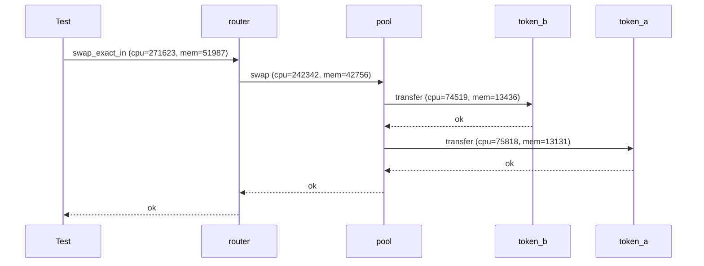

# Worked Example: Constant Product AMM

A multi-contract DeFi protocol: two ERC-20 style tokens, a constant-product (`x * y = k`) pool that mints LP share tokens, and a router that forwards swaps to the pool. It is the reference for testing several contracts that call each other — registration in one environment, authorization trees three levels deep, slippage guards, LP fee accrual, and the invariant proved with property tests. Everything here is real code in [`examples/amm`](https://github.com/stellar-crucible/soroban-testkit/tree/main/examples/amm), a workspace member you can run.

<div class="tk-spec">
  <div class="tk-spec__item"><span class="tk-spec__key">Source</span><span class="tk-spec__value">examples/amm</span></div>
  <div class="tk-spec__item"><span class="tk-spec__key">Crates</span><span class="tk-spec__value">fixtures · assert · core · generators</span></div>
  <div class="tk-spec__item"><span class="tk-spec__key">Tests</span><span class="tk-spec__value">48 passing (1 ignored recorder)</span></div>
  <div class="tk-spec__item"><span class="tk-spec__key">Run</span><span class="tk-spec__value">cargo test -p soroban-testkit-example-amm</span></div>
</div>

## The contracts

Three `#![no_std]` contract types, deployed five times:

| Contract | Deployed as | Role |
|----------|-------------|------|
| `AmmToken` | `token_a`, `token_b` | The pool's two assets: balances and allowances in persistent storage, metadata and supply in instance storage |
| `AmmToken` | `share` | The LP share token. Its admin is the pool, so only the pool can mint shares |
| `ConstantProductPool` | `pool` | Holds the reserves, mints and burns shares, swaps along `x * y = k` |
| `Router` | `router` | User-facing entry point that forwards a swap to a pool |

```text
            user signs once
                  │
                  ▼
   router.swap_exact_in ──▶ pool.swap ──▶ token_in.transfer(user → pool)
                                     └──▶ token_out.transfer(pool → user)
```

The pool is deployed first, so the share token can name it as admin, and then
initialized with all three token addresses:

```rust
let token_a = env.register(AmmToken, (admin.clone(), 7u32, String::from_str(&env, "Token A"), String::from_str(&env, "TKA")));
let token_b = env.register(AmmToken, (admin.clone(), 7u32, String::from_str(&env, "Token B"), String::from_str(&env, "TKB")));
let pool = env.register(ConstantProductPool, ());
let share = env.register(AmmToken, (pool.clone(), 7u32, String::from_str(&env, "Pool Share"), String::from_str(&env, "LP")));
let router = env.register(Router, ());
ConstantProductPoolClient::new(&env, &pool).initialize(&token_a, &token_b, &share, &30);
```

### The math

The arithmetic is in free functions so property tests can exercise it without
a contract in the loop.

A swap of `amount_in` with a fee of `fee_bps` pays out

$$\text{out} = \left\lfloor \frac{\text{in} \cdot (10000 - \text{fee}) \cdot R_{out}}{R_{in} \cdot 10000 + \text{in} \cdot (10000 - \text{fee})} \right\rfloor$$

which always leaves $(R_{in} + \text{in})(R_{out} - \text{out}) \ge R_{in} R_{out}$.
The fee stays in the pool, so `k` grows with every trade — that growth is what
liquidity providers earn. The pool re-checks the invariant after computing the
output and refuses with `AmmError::InvariantViolated` if it ever fails.

The first deposit mints $\lfloor\sqrt{a \cdot b}\rfloor$ shares, of which
`MINIMUM_LIQUIDITY` (1,000) are locked so a dust-sized first deposit cannot set
an absurd share price. Later deposits are first trimmed to the pool ratio
(`optimal_deposit`) and mint the smaller of the two proportional claims
(`shares_for_deposit`), so a lopsided deposit cannot dilute existing holders.

### Errors

```rust
#[contracterror]
pub enum AmmError {
    AlreadyInitialized = 1, NotInitialized = 2, InvalidAmount = 3,
    SlippageExceeded = 4, InsufficientLiquidity = 5, InvalidFee = 6, InvariantViolated = 7,
}

#[contracterror]
pub enum TokenError { NegativeAmount = 100, InsufficientBalance = 101, InsufficientAllowance = 102 }
```

Token codes start at 100 on purpose. A token failure inside `pool.swap`
propagates out of the pool with its own code; if the ranges overlapped, a
token's `InsufficientBalance = 2` would read as the pool's `NotInitialized`.

## The test suite

One file per testkit crate, sharing a deployment helper in `tests/common`:

| File | Crate | Tests |
|------|-------|-------|
| `tests/fixtures.rs` | soroban-testkit-fixtures | 12 |
| `tests/assert.rs` | soroban-testkit-assert | 17 |
| `tests/budget_and_storage.rs` | soroban-testkit-core | 11 (+1 ignored recorder) |
| `tests/property.rs` | soroban-testkit-generators + proptest | 8 |

### Fixtures: multi-contract context registration

`TestContextBuilder::with_users(3)` gives an LP, a trader and a second LP in
the same environment as all five contracts:

```rust
let ctx = TestContextBuilder::new().with_users(3).build();
let amm = Amm::deploy(&ctx.env, &ctx.admin, DEFAULT_FEE_BPS);
for user in &ctx.users {
    amm.fund(user, 1_000_000 * ONE);
}
```

The suite checks share minting (`sqrt(a * b) - MINIMUM_LIQUIDITY` first,
proportional after), that a lopsided deposit only takes the pool ratio, that a
swap pays exactly the quote and moves both reserves, that the router swaps
exactly like a direct call, pro-rata withdrawals, and LP fee accrual: after ten
round-trip trades `k` has grown and the LP withdraws more than it deposited.

It also uses the TTL helpers on LP balances. A share balance is a persistent
entry; left untouched past its TTL it is archived, and once swept off the
ledger it reads as zero until restored:

```rust
let key = TokenKey::Balance(lp.clone());
assert_eq!(ctx.ttl(&amm.share, &key).tier, StorageTier::Persistent);

ctx.fast_forward_to_expiration(&amm.share, &key);
ctx.assert_persistent_archived(&amm.share, &key);

ctx.archive_expired(0);
assert_eq!(amm.share().balance(&lp), 0);
```

### Assert: events, sub-invocation auth and exact errors

Events are asserted per contract, which matters with five contracts emitting:

```rust
amm.pool().deposit(&lp, &(1_000 * ONE), &(1_000 * ONE), &0, &0);

EventMatcher::new(&env).from_contract(&amm.pool).with_topic("deposit").assert_emitted();
assert_event_topic_count!(env, "transfer", 2);
assert_event_topic_count!(env, from = amm.share, "mint", 1);
```

A routed swap needs one signature from the trader that covers three levels.
`assert_auth_sub_invocation!` finds the token transfer at any depth of the
recorded tree:

```rust
amm.router().swap_exact_in(&amm.pool, &trader, &false, &(3_000 * ONE), &0);

assert_auth_matches!(env, { invoker: trader, function: "swap_exact_in" });
assert_auth_sub_invocation!(env, {
    contract: amm.token_a,
    function: "transfer",
    args: [trader.clone(), amm.pool.clone(), 3_000 * ONE],
});
```

The same tree written out as a `MockAuth` is enough for the swap to succeed
without `mock_all_auths`; dropping the nested `pool.swap` and
`token.transfer` entries makes the call fail.

Slippage guards and configuration errors are asserted by variant with
`assert_contract_error!`, so a test cannot pass by failing for the wrong reason:

```rust
let quoted = amm.pool().quote(&true, &(1_000 * ONE));
assert_contract_error!(
    amm.pool().try_swap(&trader, &true, &(1_000 * ONE), &(quoted + 1)),
    AmmError::SlippageExceeded
);
```

A token failure beneath the pool carries a `TokenError` code the pool's
client cannot name, so it is asserted as a raw contract error:

```rust
assert_host_error!(
    amm.pool().try_swap(&broke, &true, &ONE, &0),
    Error::from_contract_error(TokenError::InsufficientBalance as u32)
);
```

`assert_balance_conserved!` closes the file: a swap moves token A between the
trader and the pool and creates none.

### Core: budget baseline, storage diffs and the call tracer

`examples/amm/budget.json` tracks the four hot paths — `swap`, `router_swap`,
`deposit`, `withdraw`. The enforcing test measures each with
`BudgetSnapshot::last_invocation` and fails when one grows more than 20% past
the committed reading:

```rust
let baseline = BudgetBaseline::load(&baseline_path()).unwrap();
for (case, cost) in measure_hot_paths() {
    baseline.guard(case).tolerance(TOLERANCE_PERCENT).assert_within(&cost);
}
```

Refresh it deliberately, then commit the file:

```bash
cargo test -p soroban-testkit-example-amm --test budget_and_storage -- --ignored record_budget_baseline
```

Storage snapshots prove a swap rewrites exactly the two reserves and nothing
else in the pool:

```rust
let before = StorageSnapshot::capture(&env, &amm.pool);
amm.pool().swap(&trader, &true, &(1_000 * ONE), &0);
let diff = before.diff(&StorageSnapshot::capture(&env, &amm.pool));
// modified keys: [ReserveA], [ReserveB]
```

`CallTracer` shows the routed swap's call tree with the cost of every frame,
and on failure points at the frame that refused:

```rust
let trace = CallTracer::capture(&env, || {
    amm.router().swap_exact_in(&amm.pool, &broke, &true, &ONE, &0)
})
.with_label(&amm.router, "router")
.with_label(&amm.pool, "pool")
.with_label(&amm.token_b, "token_b");

assert_eq!(
    trace.render_failure_path().unwrap(),
    "router::swap_exact_in -> pool::swap -> token_b::transfer (error: Contract(101))"
);
```

For a successful swap, `render_ascii()` prints:

```text
router::swap_exact_in [ok] cpu=271623 mem=51987
└── pool::swap [ok] cpu=242342 mem=42756
    ├── token_b::transfer [ok] cpu=74519 mem=13436
    └── token_a::transfer [ok] cpu=75818 mem=13131
```

And `render_mermaid()`:



### Generators: the invariant under arbitrary trade sizes

Strategies are built from `token_amount()` and bounded so `reserve * reserve`
cannot overflow an `i128`:

```rust
fn reserve() -> impl Strategy<Value = i128> {
    token_amount().prop_map(|amount| amount % 1_000_000_000_000_000 + 1)
}
```

The pure-math properties run 256 cases each: a quoted swap never decreases
`k` and never drains the output side, a higher fee never pays out more,
`integer_sqrt` is the exact floor, an optimal deposit never exceeds what was
offered, and minted shares never claim more of the pool than was deposited.

Against a live pool (32 cases each), a random sequence of swaps in both
directions keeps `k` non-decreasing and pays exactly the quote, and a deposit
followed by an immediate withdrawal never returns more than went in. A
generated `account_address()` is funded and trades, to show generator
addresses are usable in a multi-contract flow.

## Running it

```bash
cargo test -p soroban-testkit-example-amm
cargo clippy -p soroban-testkit-example-amm --all-targets -- -D warnings
```
